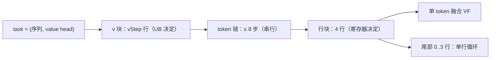
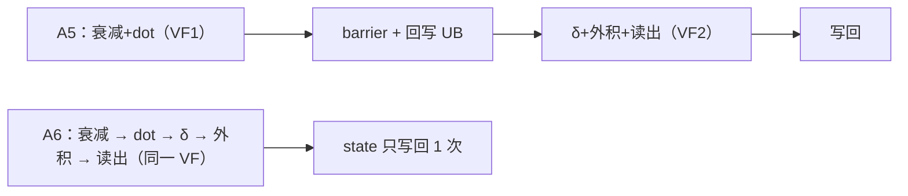
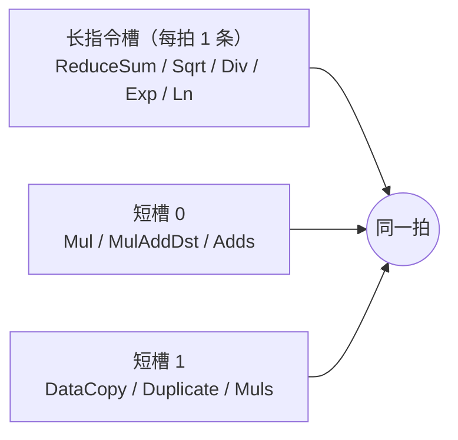

# recurrent_kda A6 优化设计（评审版）

> **已废弃**：本文描述的是被替换的上一版 `arch92/recurrent_kda.h`（融合 VF + vStep 加深）。
> A6 现已整体改为 A5 新实现的静态 UB 路径，当前设计见 [design_960dt.md](./design_960dt.md)。

> **范围**：`op_kernel/arch92/recurrent_kda.h`（DAV_9201 / 960dt）相对 A5（`arch35`，DAV_3510）。
> **口径**：K=V=128、FP32 state、nv=96；实际值以 tiling 打印的 `vStep / stateOutBufferNum / attnOutBufferNum / ubRestBytes` 为准。
> **链接**：`../op_kernel/...` 为相对路径，`#L` 为起始行，IDE 可直接跳转。

---

## 0. 摘要

本设计面向 DAV_9201（960dt）的 K=128 路径，在不改变公开接口与数学语义的前提下，利用三项硬件能力重构 A5 的向量实现：向量寄存器可编程（RegBase）、每拍可并行发射 1 条长指令与 2 条短指令、以及 384KB UB。改造范围限定在三处 VF 特化与 tiling 的 UB 候选策略；K≠128 与 K-first/V-first 路径保持原实现。

收益主要来自三处：每 token 的 state 由两次 UB 往返降为一次、两段 VEC 合并为一段并去掉段间 barrier、`vStep` 由 64 提升到 128 使每个 task 的 V-tile 从 2 轮降为 1 轮。三发是辅助手段，用于掩盖 `ReduceSum` 等长指令的等待，不作为吞吐倍增的前提。

| 指标（K=V=128、FP32 state、nv=96） | A5 | A6 | 变化 |
|---|---|---|---|
| 每个 (token, v 块) 的 VEC 段数 | 2 | 1 | −1（两趟融合） |
| 每 token 的 VF 进入次数（V=128） | 4（2 块 × 2 段） | 1（1 块 × 1 段） | −3 |
| 每 token state 的 UB 流量（V=128） | 256KB | 128KB | −50% |
| vStep / repeat | 64 / 2 | 128 / 1 | ×2 / −1 |
| state 输出 ring 级数 | 2 | 1 | −1（主线配置） |
| attn 输出 ring 级数 | 2 | 2 | 0 |
| UB 利用率 | 91.5% | 92.6% | +1.1pp |
| 归一化 barrier（8 行） | 32 次 + 8 次 `SyncVToS` | 1 次 + 0 | 大幅减少 |
| gate barrier（8 行，safe） | 约 56 次 | 1 次 | 大幅减少 |

设计要点：

1. 状态与 `dot` 留在寄存器，跨 token 只写回一次；
2. 每拍处理 4 行 × 2 段，8 条独立短指令流与长指令同拍；
3. UB 的增量只进入与 `vStep` 线性相关的区域，固定区与行级 scratch 不变（详见 §5.2）。

---

## 1. 硬件差异 → 设计选择

| 硬件特性 | A5（arch35） | A6（arch92） | 代码落点 |
|---|---|---|---|
| 向量寄存器可编程 | 以 UB `LocalTensor` 为主 | 状态/dot/δ 留在 `RegTensor` | `ProcessTokenFused128` |
| 发射宽度 | 常规单流 | **1 长 + 2 短**同拍 | 4 行 × 2 段 = 8 条短流 |
| 标量指令 | 64 lane | 收拢到 **VL1** | `MaskPattern::VL1` |
| 段间同步 | 每 token 两段 VF + barrier | 单段 VF，块末 1 次 barrier | `Compute` |
| UB | ≈248KB | **384KB** | tiling 由平台上报 |



两个独立维度：`vStep` 决定 tile 里有多少行（UB），`A6_ROW_BLOCK` 决定一拍同时算几行（寄存器与发射宽度）。

| 术语 | 含义 |
|---|---|
| **VF** | `__VEC_SCOPE__` 括起来的一段向量代码；进入/退出是同步边界，跨 VF 的指令不能互相填槽 |
| **VL** | 向量长度，一个寄存器 64 个 fp32 lane（`V_LENGTH`）；**VL1** 指只开 1 个 lane 的掩码 |
| **ring** | 输出侧的环形缓冲（TQue 深度），让“写回 GM”与“下一次计算”重叠；深度 2 = 两级 |
| **双缓冲** | 输入侧预取队列（2 级），下一块数据在当前块计算时搬运 |
| **vStep** | 一个 v 块覆盖多少 v 行（由 UB 决定） |
| **ROW_BLOCK** | 一拍同时处理多少 v 行（由寄存器与发射宽度决定） |

---

## 2. 计算主线：两趟 → 一段

| 维度 | A5 | A6（当前） |
|---|---|---|
| 每个 v 块的 VEC 段 | 2 段（衰减+dot / δ+外积+读出） | **1 段** |
| state UB 读 / 写 | 2 / 2 | **1 / 1** |
| `dot` 存放 | `deltaInUb`（UB 标量） | `d0..d3` 寄存器 |
| 衰减后的 state | 写回 UB 再读回 | 留寄存器 |
| 标量链宽度 | 64 lane | VL1 |



数学不变：`S_t = (I − βkkᵀ)·diag(α)·S_{t−1} + βkvᵀ`，`o_t = scale·qᵀS_t`；A6 只改“中间结果放哪”。

---

## 3. 三处 VF 特化（以当前代码为准）

### 3.1 `NormalizeRowsVF128`

| 项 | A5 | A6 |
|---|---|---|
| 并行度 | 1 行 | 4 行 × 2 段 |
| 归约 | `ReduceSum` 写 UB | `ReduceSum` 写寄存器 |
| 倒数/广播 | 标量 `1/norm` + `Muls` | VL1 `Div` + `Duplicate` |
| 同步 | 每行 4 barrier + 1 `SyncVToS` | 整块 1 barrier |
| eps | 无（`norm>0` 保护） | `+1e-6` |

> 8 行时：barrier 从 32 次降到 1 次，`SyncVToS` 从 8 次降到 0。

### 3.2 `ProcessTokenFused128`（当前已按行交织）

```text
一个 4 行块：
  load×8
  行0: 衰减2 → 乘加2 → RS ─┐
  行1: 衰减2 → 乘加2 → RS ─┤ 每条 RS 的长窗口
  行2: 衰减2 → 乘加2 → RS ─┤ 由下一行的短指令填充
  行3: 衰减2 → 乘加2 → RS ─┘
  v 广播×4 → 行0 δ→Dup→外积2 → 行1 … → 行3
  读出：行i 乘加2 → RS → 写回2（attn 写延迟一行）
```

- 每行内部依赖严格：`衰减 → dot → RS → δ → 外积 → o → RS`；并行只来自另外 3 行。
- 交织的目的：避免 4 条 `ReduceSum` 连发，让长指令后面始终有下一行的短指令。

### 3.3 `ApplyGateInKernelVF`（当前两波调度）

| 分支 | 公式 | 当前调度 |
|---|---|---|
| safe | `lowerBound · sigmoid(expA·raw)` | wave0（行 0/1）`Muls→Exp`，wave1 的 `Muls` 填窗口；`Div` 同理 |
| unsafe | `−expA · softplus(raw)` | `Exp` 前没有可插入的短指令，`Exp` 仍 8 连发；`Ln` 拆成 4+4，由另一波 `Adds` 隔开 |

> 注意：unsafe 的 `Exp` 前**不能**加 `Muls`，否则改变公式。

---

## 4. 三发的使用边界



四条约束，以及当前代码的满足情况：

| # | 约束 | 当前代码 |
|---|---|---|
| 1 | 长指令彼此串行，只能与短指令并行 | 已把长指令拉开（行交织/两波）；`Sqrt+Div→Rsqrt` 仍是候选 |
| 2 | 可用长指令替换普通指令换取短槽 | 待评估（`Rsqrt`、单条 `Sigmoid`），需 API/精度确认 |
| 3 | 三发只在**同一 VF**内、长短互不依赖时发生 | 三个 VF 分开且各有 barrier，跨 VF 不叠加 |
| 4 | 需手动 UnRoll，且不用 `PostModeUpdate` | 128 路径全部手写 4 行展开 + 显式 `addr + offset`；`UpdateMask` 循环只在 K≠128 通用路径 |

**量级**：每 4 行块约 68 条短指令、8 条长指令，按“1 长 + 2 短”理想排布也只需约 34 拍，长槽最多忙 8 拍（≈24%）。所以**三发是辅助，真正的收益在 §2 的往返与 §3 的同步**。

---

## 5. UB 切分：248KB → 384KB

### 5.1 预算公式

```text
fixed   = 8 token 的 q/k/g/v 镜像 + β 行 + guard        = 15,424 B
working = fixed + 行级 scratch                        = 34,880 B
coeff   = state 双缓冲 + 转置 + state/attn ring + compute = 2,570 B/行（ring 1/1，K-first）

vStep = (UB − working) / coeff → 对齐 16 → 收敛到最小 repeat
```

### 5.2 与 A5 的元素级差异

| 元素 | A5（vStep 64） | A6（vStep 128） | 增量 | 变化原因 |
|---|---|---|---|---|
| 固定区 + 行级 scratch | 34.1KB | 34.1KB | 0 | 只由 `MAX_MTP` 与 K/V 决定 |
| state 输入双缓冲 | 64.0KB（2 × 32） | 128.0KB（2 × 64） | **+64.0** | `vStep` 翻倍 |
| K-first 转置 buffer | 32.0KB | 64.0KB | **+32.0** | `vStep` 翻倍 |
| state 输出 ring | 64.0KB（2 × 32） | 64.0KB（1 × 64） | 0 | 级数 2→1，抵消单级放大 |
| compute 切片 | 32.5KB | 65.0KB | **+32.5** | `(4·K + 8) × vStep` |
| attn 输出 ring | 0.25KB | 0.50KB | +0.25 | `2B × vStep` |
| 空闲 | 21.2KB | 28.4KB | +7.2 | 对齐取整后的余量 |
| **合计** | **226.8 / 248KB** | **355.6 / 384KB** | **已用 +128.8 / 预算 +136** | |

```text
元素                  A5（vStep 64）           A6（vStep 128）          增量
固定区+scratch        ████ 34.1KB              ████ 34.1KB              —
state 输入双缓冲       ████████ 64.0KB          ████████████████ 128.0KB +64.0
K-first 转置          ████ 32.0KB              ████████ 64.0KB          +32.0
state 输出 ring       ████████ 64.0KB          ████████ 64.0KB          ±0
compute 切片          ████ 32.5KB              ████████ 65.0KB          +32.5
attn 输出 ring        (0.25KB)                 (0.50KB)                 +0.25
空闲                  ███ 21.2KB               ████ 28.4KB              +7.2
```

**多出的 136KB 去了哪里**：约 **71%** 用于把 `vStep` 从 64 抬到 128——state 输入双缓冲 +64KB、K-first 转置 +32KB；约 **24%** 进入 compute 切片（+32.5KB）；剩余 **5%** 是对齐后的空闲（+7.2KB）。固定区与行级 scratch 完全没有变化；state 输出 ring 也没有增加，因为级数从 2 降到 1，正好抵消单级容量翻倍。

> 注意区分：`state 输入双缓冲` 的**级数不变（2 级）**，只是每级随 vStep 翻倍；真正减少的是 `state 输出 ring` 的**级数**（2→1），单级翻倍正好抵消，所以这两项的总量都没有因“级数变化”而增加或减少。

四种配置的最终取值：

| 配置 | vStep | repeat | ring（state/attn） | 已用 / 预算 | 余量 |
|---|---|---|---|---|---|
| A5 | 64 | 2 | 2 / 2 | 226.8 / 248KB（91.5%） | 21.2KB |
| A6 主线 | 128 | 1 | 1 / 2 | 355.6 / 384KB（92.6%） | 28.4KB |
| A6 逐 token 落盘（K-first） | 64 | 2 | 2 / 2 | 226.8 / 384KB（**59.1%**） | **157.2KB** |
| A6 逐 token 落盘（V-first） | 128 | 1 | 2 / 2 | 355.6 / 384KB（92.6%） | 28.4KB |

### 5.3 没用满的原因

1. **输出 ring 上限 2**：pending 只保留一个待写副本，深度 2 已够重叠，再深要改 TQue/pending 结构。
2. **state ring 贵、attn ring 便宜**：vStep=128 时 state 每级 64KB，attn 每级仅 256B，剩余 28KB 只够加深 attn。
3. **vStep 不能任意取值**：必须整除 V（128 时只有 128、64），硬凑会引入 16 行尾块。
4. 逐 token 落盘场景为了 ring 2 主动退回 vStep 64，于是余下 **157KB**；该档位只在“无 `cu_seqlens` 且 `seqLen ≤ 8`”时才会被选中。
5. V=128 的长序列支持要求 `vStep = dv = 128`——状态必须正好是一个 v 块，才能跨 8-token 窗口驻留 UB。因此一旦可能存在长序列（带 `cu_seqlens`，或 dense `seqLen > 8`），tiling 直接排除 `vStep < dv` 的候选，上面 59.1% 的 2/2 档位不再出现。

---

## 6. 理论收益与验证

| 项 | A5 | A6（当前） | 理论收益 |
|---|---|---|---|
| 每 token state UB 读/写 | 2 / 2 | 1 / 1 | 省一次整 tile 往返（vStep=128 时约 64KB 读 + 64KB 写） |
| 每个 v 块的 VEC 段/barrier | 2 段 + 1 barrier | 1 段 + 0 | 少一次 VF 进入/退出与同步 |
| 每 task V-tile | 2（vStep 64） | 1（vStep 128） | 少一轮循环与状态搬入搬出 |
| 归一化（8 行） | 32 barrier + 8 `SyncVToS` | 1 barrier + 0 | 去掉 V→S 串行 |
| gate（8 行，safe） | 约 56 barrier | 1 barrier | 去掉逐 op 同步；长指令连发 8→4 |
| 寄存器占用 | 低 | 8 状态 + 常量/临时 | 4 行是稳定上限，8 行会溢出 |

> 以上为**理论值**，需要 profiling 兑现；不等于线性加速。

**验证口径**：
1. plog / tiling 字段：`vStep`、`ring`、`ubRestBytes` 是否符合 §5.2。
2. `msprof op simulator`：长槽 busy、总周期；对照 §4 的 24% 上限。
3. ATK 精度：1..8 token、K-first/V-first、`safe_gate` 开/关、有无 `dt_bias`。
4. 回退点：两处调度都可单独恢复原顺序，便于 A/B。

---

## 7. 风险与下一步

| 风险 | 说明 | 应对 |
|---|---|---|
| 理论收益未兑现 | 编译器可能已做同样调度 | 先 A/B 测周期，无收益即回退 |
| eps 口径差异 | A5 无 eps，A6 有 1e-6 | 精度用例覆盖极小范数行 |
| 寄存器压力 | 4 行已接近上限 | 不加大行块；8 行先评估溢出 |
| 157KB 闲置 | ring 上限 2 + vStep 约束 | 用于下一 tile 的 QKV 预取、第二转置 buffer |

**下一步优先级**：
1. 用余量做“下一 tile QKV 预取”（约 10.2KB），把输入搬运藏到计算后面；
2. 评估 `Sqrt+Div → Rsqrt`（长指令 8→4）；
3. ring 3 放到最后（需改 pending/TQue 结构）。

---

## 附：关键代码

| 内容 | 位置 |
|---|---|
| 融合 token VF | [`ProcessTokenFused128`](../op_kernel/arch92/recurrent_kda.h#L1171) |
| 归一化 VF | [`NormalizeRowsVF128`](../op_kernel/arch92/recurrent_kda.h#L527) |
| gate VF | [`ApplyGateInKernelVF`](../op_kernel/arch92/recurrent_kda.h#L664) |
| 行块常量 | [`A6_ROW_BLOCK`](../op_kernel/arch92/recurrent_kda.h#L56) |
| UB 预算 | [`CalcVStepCoeff`](../op_host/recurrent_kda_tiling_processor.h#L709) / [`DeepenOutRingForA6`](../op_host/recurrent_kda_tiling_processor.h#L808) |
