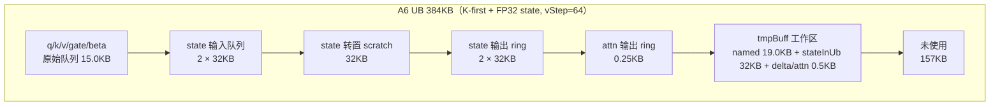
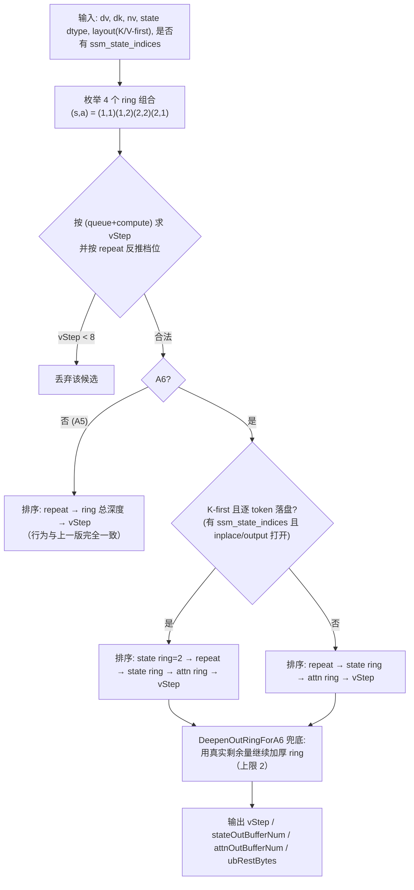
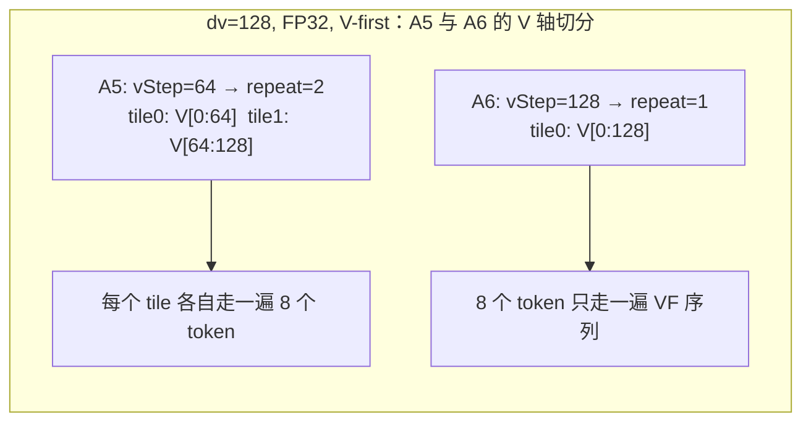
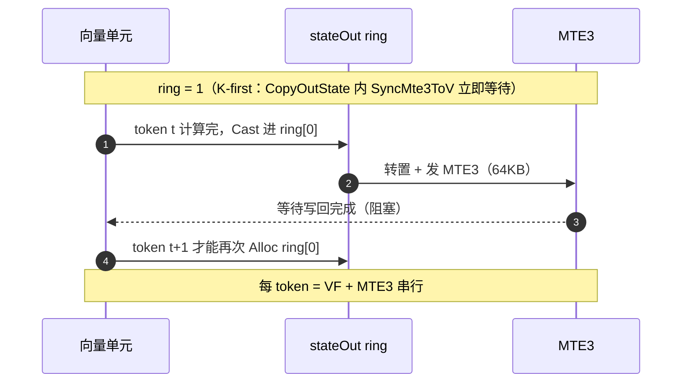
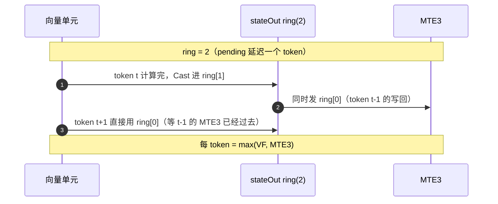

# RecurrentKda ascend960dt（A6）专项设计与优化

> 本文只讲 **A6（`ascend960dt`，`DAV_9201`）与 A5（`ascend950`，`DAV_3510`）不同** 的部分：
> 硬件差异带来哪些新机会、代码怎么改、为什么这么改、改完之后 UB 用到什么程度、还剩什么可做。
> 算子通用语义（公式、接口、tiling 字段、精度策略）见 [design.md](./design.md)。
>
> 阅读顺序建议：先看第 1 节结论，再按需看第 3 节（三发射）和第 4 节（384KB UB）；第 6 节是
> A5→A6 的代码差异总表，评审可直接对着它看 diff。

---

## 1. 结论速览

| 问题 | 结论 |
| --- | --- |
| A6 相对 A5 的两项硬件增量 | vector **三发射**（1 长 + 2 短/拍）与 **UB 248KB → 384KB** |
| 三发射怎么用 | 把 V 方向相邻 4 行（互不依赖）× 每行前后两段 64 lane 编成 **8 条短指令流**；`ReduceSum`/`Exp`/`Ln`/`Div` 这类长指令只占长指令槽，另一行同阶段的短指令填满 2 个短槽 |
| 384KB 怎么用 | ① 抬高 `vStep` 减少 V 轴 tile 数；② 加厚 state/attn 输出 ring，让 MTE3 写回与下一个 token 的向量计算重叠；③ 无 `ssm_state_indices` 时把"每 token 一次 state 写回"折叠成"每任务一次" |
| UB 用满了没有 | **没有**，A6 各形状落在 59%~95%。原因不是漏配，而是 **vStep 只能按 (16 对齐 × repeat 整除) 跳档**、ring 深度被 kernel 的 pending 窗口卡在 2、输入队列 2 级已足够 —— 见 4.4/4.5 |
| 本文档对应改动 | `arch92` 内核 3 处（两处指令折叠 + 一处 state 写回合并），`op_host` tiling 1 处（A6 专属候选排序）；A5 代码不变 |

本次（相对上一版 A6 实现）新增的三项：

1. **state 写回合并**：无 `ssm_state_indices` 时，同一 `(batch, head)` 任务内所有 token 命中同一个
   state 槽，中间态写回必然被后一个 token 覆盖，因此只写最后一个 token（GM 结果逐位不变，
   每任务的 state MTE3 从 `T` 次降到 1 次）。
2. **A6 候选排序感知"写回语义 + state 布局"**：有 `ssm_state_indices`（逐 token 落盘）且 K-first 时，
   把 "state 输出 ring = 2" 提到 `repeat` 之前 —— 这是 fp32 + K-first 形状从
   `(repeat=1, ring 1/2)` 修正为 `(repeat=2, ring 2/2)` 的依据。
3. **指令折叠**：L2 normalize 的"平方+相加"折叠成一条 `MulAddDst`；raw gate 的
   `Muls(expA)` + `Muls(-1)` 折叠成一条 `Muls(-expA)`；raw gate 行块从 2 行扩到 4 行。

---

## 2. 平台差异：A5 vs A6

### 2.1 硬件差异

| 维度 | A5（ascend950 / DAV_3510） | A6（ascend960dt / DAV_9201） | 对本算子的含义 |
| --- | --- | --- | --- |
| vector UB | 约 248KB | **384KB** | 更大的 `vStep`、更深的输出 ring |
| vector 发射 | 双发射（1 长 + 1 短 / 拍） | **三发射（1 长 + 2 短 / 拍）** | 需要 ≥3 条互不依赖的指令流才能吃到 |
| 内核选择宏 | `__CCE_AICORE__ == 310` | `__NPU_ARCH__ == 9201` | `op_kernel/recurrent_kda.cpp` 按宏选文件 |
| host 平台标识 | `isRegbase = 1` | `isRegbase = 1` + `isA6 = 1` | tiling 一份代码同时服务两个平台 |

### 2.2 代码结构差异

| 维度 | A5 | A6 |
| --- | --- | --- |
| kernel 文件 | `op_kernel/arch35/recurrent_kda.h`（A2/A3 也走这里） | `op_kernel/arch92/recurrent_kda.h`，仅 A6 编译 |
| 一个 token 的向量处理 | **两段 VF**：`DecayMatVecReduce128` → `PipeBarrier<PIPE_V>` → `ProcessDeltaKQReduce128` | **一段融合 VF**：`ProcessTokenFused128`（decay / `S@k` / delta / outer / `S@q` 一次完成） |
| state 的 UB 往返 | 每行：2 读 2 写（decayed state 要落 UB 再读回） | 每行：1 读 1 写（decayed state 只在寄存器里推进） |
| 行内并行度 | 逐行，最多 2 段（奇偶交织 `DIST_DINTLV_B32`） | 4 行 × 2 段连续 64 lane = 8 条独立短指令流 |
| 归约 | `Mul`+`Mul`+`Add`+`ReduceSum` | `Mul`+`MulAddDst`+`ReduceSum`（FMA 折叠） |
| beta sigmoid / delta | 64 lane 全发射 | `MaskPattern::VL1`（只占 1 lane） |
| q/k L2 normalize | 逐行 `Mul`/`ReduceSum`/`Sqrt`，每行 4 次 `PipeBarrier` + `V→S` 同步 + 标量回读 | 整块一个 VF，4 行一组；`rstd` 用寄存器 `Duplicate` 广播，零 `V→S` |
| raw gate 变换 | 逐 op `PipeBarrier` + 逐行 `dt_bias` 加法 | 整块一个 VF，4 行一组，`dt_bias` 入口装载一次 |
| L2 eps | `x/sqrt(sum)`，范数 0 跳过 | `x/sqrt(sum+1e-6)`（对齐 A2/A3 与 x8-pr） |
| state 写回 | 每 token 必写 | 无 `ssm_state_indices` 时只写最后一个 token（见 5.1） |
| UB 切分 | 3 个候选，`repeat` 优先 | 4 个候选，并感知 state 布局与写回语义（见 4.2） |

---

## 3. 特性一：vector 三发射

### 3.1 三发射成立的条件

一条 3 发射的拍里放的是 **1 条长指令 + 2 条短指令**，因此 kernel 内必须同时具备：

1. 一个 `__VEC_SCOPE__` 里有 **≥3 条互不依赖** 的指令流可发；
2. 长指令落在某条依赖链的等待窗口里，且该窗口内有别的行的短指令可填；
3. 不要用 64 lane 去算 1 个标量（浪费寄存器带宽，也让编译器难排）。

### 3.2 本算子的指令分类

| 类别 | 本算子涉及指令 | 说明 |
| --- | --- | --- |
| 长指令 | `ReduceSum`、`Exp`、`Ln`、`Div`、`Sqrt` | 多周期、占专用资源 |
| 短指令 | `Mul`、`Add`、`Sub`、`Muls`、`Adds`、`Duplicate`、`MulAddDst`、`DataCopy`（寄存器↔UB，含 `DIST_BRC_B32` / `DIST_FIRST_ELEMENT_B32`） | 64 lane 逐元素 / 搬运 |

> 该分类是算子侧按 9201 向量单元的命令口径给出的假设，**需真机 profiler 确认**每个指令是否被
> 打包进长/短槽；本节的排布论据只依赖"长指令少、短指令多"这一形态。

### 3.3 封装模式 A：行块 × 两段 = 8 条短指令流

`K = 128 = 2 × V_LENGTH(64)`，`state` 在 UB 内是 V-first `[vStep][128]`，一行 128 个 float 正好
两段连续 64 lane。V 方向相邻 4 行共用同一个 token 的 `k/q/gate`，彼此**没有任何数据依赖**：

```text
state[i][:] *= gate[:]                 # decay
dot[i]      = sum(state[i][:] * k[:])  # S@k
delta[i]    = (v[i] - dot[i]) * beta
state[i][:] += delta[i] * k[:]         # outer 更新
o[i]        = sum(state[i][:] * q[:])  # S@q（用更新后的 state）
```

于是 4 行 × 2 段 = 8 条独立短指令流，长指令（`ReduceSum`）夹在中间：

```mermaid
gantt
    title 一个 4 行行块的发射示意（横轴单位＝拍；短槽每拍 2 条、长槽每拍 1 条）
    dateFormat X
    axisFormat %s
    section 短指令槽（每拍 2 条）
    state 载入 8 条        :s1, 0, 4
    decay 8 条             :s2, 4, 4
    S@k 8 条               :s3, 8, 4
    v 广播 4 条            :s4, 12, 2
    delta 8 条（VL1）       :s5, 14, 4
    delta 广播 4 条         :s6, 18, 2
    outer 更新 8 条         :s7, 20, 4
    S@q 8 条               :s8, 24, 4
    state 回写 8 条         :s9, 28, 4
    attn 首元素回写 4 条     :s10, 32, 2
    section 长指令槽（每拍 1 条）
    ReduceSum×4（S@k）      :l1, 12, 4
    ReduceSum×4（S@q）      :l2, 28, 4
```



> 位置是"理想打包"的示意（68 条短指令 → 34 拍，2 组 4 条 `ReduceSum` 各占 4 拍），
> 实际由编译器调度；这条示意只说明"长指令槽有大段空闲、短指令槽才是瓶颈"。

要点：

- 短指令 68 条、长指令 8 条。**短槽 2 条/拍才是瓶颈**，长槽只占 8 拍 —— 所以优化的着力点是
  "减少短指令条数"和"让短指令成对发射"，而不是省长指令；
- 4 行一组而不是 2 行：2 行只有 4 条流，`ReduceSum` 之后的 `Sub/Mul/Duplicate` 会顶在关键路径上；
- 为什么用"连续两段"而不是 A5 的奇偶交织（`DIST_DINTLV_B32`）：连续两段与 A5 的行内语义
  （前 64 列 / 后 64 列）一一对应，精度比对可读；奇偶交织把同一行的两半打散到相邻 lane，调试困难。
  交织版的代码在 A5（arch35）里保留，A6 不再使用。

### 3.4 封装模式 B：标量链收敛到 `VL1`

`beta`（每 token 一个）、`delta`（每行一个）、`rstd`（每行一个）都只有 1 个有效值，但 A5 用
64 lane 在算。A6 全部改成 `MaskPattern::VL1`：

```cpp
MaskReg pregFirst = CreateMask<float, MaskPattern::VL1>();
DataCopy<float, LoadDist::DIST_BRC_B32>(beta, betaAddr);   // 1 条短指令
Muls(beta, beta, -1.0f, pregFirst);                        // sigmoid 全链只开 lane0
Exp(beta, beta, pregFirst);
Adds(beta, beta, 1.0f, pregFirst);
Duplicate(one, 1.0f, pregFirst);
Div(beta, one, beta, pregFirst);
```

收益有两层：① 不再为 64 lane 的无效结果分配寄存器、搬运数据；② `Sub`/`Mul`/`Duplicate` 的输入
只有 lane0 有定义，编译器不需要保持整行的数据一致性。

### 3.5 封装模式 C：跨行填充长指令窗口（raw gate）

raw gate 变换是"整块、逐元素、同一串长指令"的典型：`Exp`/`Ln`/`Div` 全是长指令，
A5 里每个 op 之间都插一个 `PipeBarrier`，等于把长指令的等待窗口全部暴露出来。

A6 的做法：整块进一个 `__VEC_SCOPE__`，行块从 2 行扩到 4 行（8 条短指令流），阶段内对齐发射：
`Muls`/`Adds` 这类短指令填 `Exp`/`Div` 的长槽，只在 VF 末尾保留一次 `PipeBarrier<PIPE_V>`。

```cpp
// op_kernel/arch92/recurrent_kda.h: ApplyGateInKernelVF
uint16_t quadNum = static_cast<uint16_t>(rowNum / A6_GATE_ROW_BLOCK);   // =4 行一组
for (uint16_t i = 0; i < quadNum; ++i) {
    // 8 条载入（与下一组的 Exp 长指令并行）
    DataCopy(x00..x31);
    if (hasDtBias_) { Add × 8 }                    // dt_bias 寄存器常驻，入口只装一次
    if (safeGate_) {
        Muls × 8 (-expA);  Exp × 8;  Adds × 8;  Div × 8;  Muls × 8 (lowerBound);
    } else {
        Exp × 8;  Adds × 8;  Ln × 8;  Muls × 8 (-expA);
    }
    DataCopy 回写 × 8;
}
```

### 3.6 指令折叠与"逐位等价"论证

| 折叠 | A5 写法 | A6 写法 | 数值影响 |
| --- | --- | --- | --- |
| 归约两段 | `Mul(p,s0,k0)` + `MulAddDst(p,s1,k1)` | 同（上一版已做） | FMA 单次舍入，≤1 ULP（算子既有口径） |
| L2 平方和 | `Mul(sq,r0,r0)` + `Mul(nd,r1,r1)` + `Add(sq,sq,nd)` | `Mul(sq,r0,r0)` + `MulAddDst(sq,r1,r1)` | FMA 单次舍入，sum 差 ≤1 ULP → rstd 相对差 ~1e-7，远小于 bf16 输入量化（~1e-2） |
| safe gate 取负 | `Muls(x,x,expA)` 再 `Muls(x,x,-1.0)` | `Muls(x,x,-expA)` | **逐位相同**：IEEE 下取负是精确操作，`-(x*expA) == x*(-expA)` |

### 3.7 指令账：为什么 19 条/行就是地板

K=128、V=128、单 token、单 V-tile（`vStep=128`）：

| 阶段 | 指令 | 条数 | 长短 |
| --- | --- | --- | --- |
| state 载入 | `DataCopy` ×8 | 8 | 短 |
| decay | `Mul` ×8 | 8 | 短 |
| `S@k` | `Mul` ×4 + `MulAddDst` ×4 | 8 | 短 |
| 归约 | `ReduceSum` ×4 | 4 | 长 |
| `v` 广播 | `DataCopy<DIST_BRC_B32>` ×4 | 4 | 短 |
| delta | `Sub` ×4 + `Mul` ×4（VL1） | 8 | 短 |
| delta 广播 | `Duplicate` ×4 | 4 | 短 |
| outer 更新 | `MulAddDst` ×8 | 8 | 短 |
| `S@q` | `Mul` ×4 + `MulAddDst` ×4 | 8 | 短 |
| state 回写 | `DataCopy` ×8 | 8 | 短 |
| `S@q` 归约 + 输出 | `ReduceSum` ×4 + `DataCopy<FIRST_ELEMENT>` ×4 | 4 + 4 | 长 + 短 |
| **合计** | | **76（短 68 + 长 8）** | |

- 每行 19 条（短 17 + 长 2），每 token（128 行）2432 条；
- 短槽 2 条/拍 → 理论下界 17/2 = 8.5 拍/行，即 1088 拍/token；
- 其中**不可再省的算术**是 8 条/行（decay 2 + `S@k` 2 + outer 2 + `S@q` 2，每段 64 lane 一次乘加）；
  其余 11 条是 state 搬运（4）+ delta 标量链（4）+ 归约（2）+ 输出（1）。

已评估但**不采用**的压法（负结论同样是设计依据）：

| 方案 | 理论收益 | 不采用的原因 |
| --- | --- | --- |
| 行块 4 → 8 行 | 16 条流，进一步藏延迟 | 寄存器账 16（state）+ 8（token 常量）+ 8（中间量）= 32，已顶到向量寄存器上限，必然 spill |
| 2 token 融入同一 VF | 省一趟 state 载入 | 会把两个 token 的 `k/q/gate/beta` 常量搬进行块内层：每 2 token 每行块 142 条短指令 > 现状 136 条（净变差） |
| state 行常驻 + token 内层循环 | 省每 token 的 state 载入 | 每 token 每行块短指令 68 → 67（-1.5%），但常量载入进入依赖链，得不偿失 |
| delta 用 `v*beta - dot*beta` | delta 链 4 → 3 条 | 改变结合律、引入相消，精度优先 → 拒绝 |
| 每 token 整 tile `Cast` 用寄存器直写替代 | 省 256 条短指令/token（约 10%） | 需要 bf16 寄存器直写 UB 的可靠支持，且破坏输出 ring 的"稳定副本"语义，列入演进（10.1） |
| 一次性 64-lane 打包回写 attn | 128 条 → 2 条 | `ReduceSum` 结果只落在 lane0，打包回 64 lane 需要额外 UB 往返，反而更贵 |

---

## 4. 特性二：UB 384KB

### 4.1 UB 预算模型

A5/A6 共用同一套 regbase 布局（`arch35`/`arch92` 一致），host 侧用三段公式记账
（`op_host/recurrent_kda_tiling_processor.h`）：

```text
fixed   = MTP*(8*aDk + 2*aDv) + MTP*4*aNv + 64 + 2048
          └ q/k/v/gate 原始 dtype 队列（单 buffer）+ beta 队列 ┘  └ scalarBuf ┘ └ guard ┘
named   = MTP*(4*aDv + 12*aDk + 4*aNv)        # q/k/gate/v/beta 的 fp32 工作镜像
queue   = 2*ss*aDk (state 输入队列 2 级) + [K-first]*ss*aDk (转置 scratch)
          + s*ss*aDk (state 输出 ring) + a*2 (attn 输出 ring)
compute = 4*aDk + 8                            # stateInUb(fp32) + delta + attn
总占用   = fixed + named + (queue + compute) * vStep        # ss=state dtype 字节, s/a=ring 深度
```

`vStep` 由 `(UB - fixed - named) / (queue + compute)` 求出后，**先按 16（K-first）/8（V-first）对齐，
再按 `repeat = ceil(dv/vStep)` 反向整除**，因此可用档位是离散的：K=V=128 时只有 `128`（repeat 1）
和 `64`（repeat 2）两档；`repeat` 一旦跳档，档间的富余量就**用不出去**（见 4.5）。

一个 tile 在 UB 里的实际排布（以 K-first、FP32 state、`vStep=64` 为例，单位 KB）：



### 4.2 候选表与选择规则



规则背后的物理依据（5.2 会再展开）：

- **K-first 的 state 写回必须"转置 → `SyncMte3ToV` 立刻等待"**（转置 scratch 是全程共享的），
  ring=1 时每 token 变成 `VF + MTE3` 串行；ring=2 时 pending 把上一 token 的写回推到下一 token
  的 VF 之后，变成 `max(VF, MTE3)`；
- **V-first 的写回是纯 `DataCopyPad` + `FreeTensor`**，ring=1 的代价只是"下一次 Alloc 等上一份
  `Cast` 之后的那次 MTE3"，不值得为它牺牲 `repeat`；
- **无 `ssm_state_indices` 时每任务只写最后一个 token**（5.1），ring 深度不再决定重叠效果，
  于是回到 `repeat` 优先，把 384KB 换成更大的 `vStep`。

### 4.3 选择结果（K=V=128 与 V=256，nv=96，T≤8）

`v`=vStep，`r`=repeat，`s/a`=state/attn ring 深度，"占用"按 4.1 的公式计算（理论值，真机请对
`OP_LOGD` 的 `vStep/stateOutBufferNum/attnOutBufferNum/ubRestBytes` 复核）。
A5 列按平台上报的 248KB 估算，A6 列按 384KB 估算；UB 实际大小一律取 `GetCoreMemSize(UB)`，
host 不写常量，因此若真机上报值不同，占用比例随之变化，但选型结论（取哪一档 vStep/ring）不变。

| state | layout | dv | A5（248KB） | A6 有 `ssm_state_indices` | A6 无 indices |
| --- | --- | --- | --- | --- | --- |
| BF16 | V-first | 128 | v128 r1 2/2 91.8% | v128 r1 2/2 59.3% | 同左 |
| BF16 | K-first | 128 | v128 r1 1/2 91.8% | v128 r1 2/2 67.6% | 同左 |
| FP32 | V-first | 128 | v64 r2 2/2 78.6% | **v128 r1** 2/2 92.6% | 同左 |
| FP32 | K-first | 128 | v64 r2 2/2 91.5% | v64 r2 2/2 59.1% | **v128 r1** 1/2 92.6% |
| BF16 | V-first | 256 | v128 r2 2/2 94.2% | v256 r1 1/2 94.5% | 同左 |
| BF16 | K-first | 256 | v128 r2 1/2 94.2% | v128 r2 2/2 69.2% | 同左 |
| FP32 | V-first | 256 | v96 r3 1/2 94.0% | v128 r2 2/2 94.2% | 同左 |
| FP32 | K-first | 256 | v64 r4 2/2 93.9% | v96 r3 2/2 85.7% | v128 r2 1/2 94.2% |

A6 的两个"看起来吃亏"的格子是**故意的**：
`FP32 + K-first + 有索引` 用 `repeat+1` 换 `state ring=2`（4.2 第一条依据）；
`FP32 + K-first + 无索引` 反过来用 `repeat=1`（因为只剩一次写回，ring 深度不再重要）。

`V` 轴切分的差别（同一个 `dv=128`、FP32、V-first 形状，A5 vs A6）：



### 4.4 UB 用满了没有：逐配置回答

| 代表配置（A6，nv=96，T≤8） | 已用 | 空闲 | 已用的构成 |
| --- | --- | --- | --- |
| BF16 V-first dv=128（v128 r1 2/2） | 233,024B（59.3%） | 156.4KB | fixed 15.1 + named 19.0 + state 输入 64.0 + state 输出 64.0 + stateInUb 等 65.0 + attn 0.5 |
| BF16 K-first dv=128（v128 r1 2/2） | 265,792B（67.6%） | 124.4KB | 同上 + 转置 scratch 32.0 |
| FP32 V-first dv=128（v128 r1 2/2） | 364,096B（92.6%） | 28.4KB | state 相关 2×64.0（输入）+ 2×64.0（输出）+ 65.0（stateInUb）+ 0.5（attn），其余 60.6 |
| FP32 K-first dv=128（v64 r2 2/2） | 232,256B（59.1%） | 157.2KB | state 相关全部按半个 tile（32KB/份）：输入 64.0 + 转置 32.0 + 输出 64.0 + stateInUb 32.0 |
| BF16 K-first dv=256（v128 r2 2/2） | 271,936B（69.2%） | 118.4KB | 结构同 dv=128 K-first，只是 fixed 17.1 + named 23.0（`aDv=256`） |

结论：**A6 没有把 384KB 用满**，最"松"的两个形状只剩不到 60%。这是"量化分配"的必然结果，
不是漏配 —— 具体四个原因见下。

### 4.5 为什么用不满（四条硬约束）

1. **`vStep` 是跳档的，不是连续的。**
   `dv=128` 时合法档位只有 `128`（repeat 1）和 `64`（repeat 2）。BF16 K-first 的
   `coeff(2,2) = 1804 B/vStep`，`vStep=128` 时 ring+compute 占 230,912B，加 fixed/named 共
   265,792B（67.6%）；此时 `repeat` 已到 1、"V 轴一次覆盖"，把 UB 从 248KB 加到 384KB 都换不到
   更多吞吐 —— 所以剩下的 124KB 不是"没算好"，而是没有可兑现的用法。
2. **state 一份 tile 被复制 4~6 次。** K-first FP32 时：输入队列 2 份（跨 tile/跨 head 预取）+
   转置 scratch 1 份 + 输出 ring 2 份 + 工作态 `stateInUb` 1 份 = 6 份。FP32 K-first 想升到
   `vStep=128`（同时保住 ring 2）只差 **35.6KB**：
   `coeff(2,2)*128 + fixed + named = 429,632B > 393,216B`（超 36,416B），
   正好是一个 state 输出 ring（64KB）的一大半 —— 这不是"再挤一点"能解决的，必须改数据流（10.1）。
3. **输出 ring 深度被 kernel 的 pending 窗口卡在 2。** `MAX_OUT_BUFFER_NUM = 2` 对应
   "保留一份待写副本"的 pending 机制：深度 2 已经足以让"上一 token 的 MTE3"与"下一 token 的 VF"
   完全重叠；再深只会占 UB，要兑现收益必须同时改 pending 队列结构。
4. **输入队列 2 级已经够用。** 按结构分析，MTE2 输入远小于向量工作量：一个 head（T=8）的
   q/k/v/gate/beta 合计约 10KB（q/k/v 各 8×128×2B，gate 8×128×4B），prologue（`Cast` + normalize +
   gate 变换）约 300 条指令，而 token 循环约 19,500 条（≈1.5%）。因此**没有**为 A6 加深
   q/k/v/gate 队列（加深还会破坏 `CalcFixedUbBytes` 与 A5 的共享口径）。

另外两处"公式级"的小浪费（不修，避免动 A5 共享口径）：
`MTP*4*aNv` 的 beta 预留（`nv=96` 时 3.0KB）比 kernel 实际用的 `MTP*16*4 = 0.5KB` 保守 2.5KB；
`fixed` 里的 2KB guard 是为 TPipe 对齐留的余量。

---

## 5. 本次新增的三项改动

### 5.1 state 写回合并（省 MTE3）

**问题**：算子对每个 token 都把整块 state 从 UB `Cast/DataCopy` 到输出 ring，再 MTE3 到 GM。
FP32、`vStep=128` 时这是**每 token 64KB**，按 MTE3 ≈32B/拍 估算约 2048 拍，而一个 token 的向量
工作只有约 1088 拍 —— 写回成了真正的瓶颈。

**观察**：`StateSlotForToken()` 在没有 `ssm_state_indices` 时恒返回 `batchIdx`，因此同一
`(batch, head)` 任务内 **所有 token 的 state 写回地址完全相同**，中间态写回必然被后一个 token
的同地址写回覆盖。`inplace_final_state` / `output_final_state` 的语义只是"任务结束时槽里的值"。

**改动**（`op_kernel/arch92/recurrent_kda.h: ProcessHead`）：

```cpp
bool storeStateNow = shouldStoreState_;
if (storeStateNow && !hasSsmStateIndices_ && seq_i + 1 < seq1) {
    storeStateNow = false;    // 下一个 token 会覆盖同一个 GM 地址
}
Compute(curSingleV, curQKOffset, curVOffset, betaOffset, storeStateNow);
...
if (storeStateNow) { /* ring + pending 逻辑原样保留 */ }
```

**正确性论证**（不涉及任何算术改动）：

1. 只在 `!hasSsmStateIndices_` 时生效，此时 `stateOffset = stride0*batch + stride1*head + ...`，
   与 token 无关（见 `CopyOutState` 的地址公式），相邻 token 的写回是**同一个 GM 地址**；
2. 任务内 token 按 `seq_i` 递增串行处理，后写覆盖先写 ⇒ 只保留最后一次写回，GM 最终内容逐位相同；
3. 有 `ssm_state_indices` 时每个 token 可能命中不同槽（speculative decode 语义），保持逐 token 写回；
4. UB 内的递推 state（`stateInUb`）仍然**每 token 更新**，只是不再落 GM。

**收益**：每 `(batch, head)` 任务的 state MTE3 从 `T`（≤8）次降到 **每个 V-tile 1 次**；
FP32 `dv=128` 的写回量从 8×64KB 降到 1×64KB。对 `repeat=2` 是 2 次。

```mermaid
gantt
    title FP32、vStep=128、ring=2：一个 head（8 token）的 VF 与 state 写回（横轴单位≈百拍）
    dateFormat X
    axisFormat %s
    section 改动前：每 token 都写回（MTE3 成为瓶颈）
    VF t0..t7（8×11）           :a1, 0, 88
    state 写回 t0..t7（8×20）    :crit, b1, 11, 157
    section 改动后：只写最后一个 token
    VF t0..t7（8×11）           :c1, 0, 88
    仅 t7 写回 64KB（20）        :d1, 88, 108
```



### 5.2 A6 候选排序感知"写回语义 + state 布局"

见 4.2/4.3。命中形状举例（FP32 + K-first + 有索引 + `dv=128`）：

| 排序规则 | vStep | repeat | rings | 每 token 行为 |
| --- | --- | --- | --- | --- |
| 旧（repeat 优先） | 128 | 1 | 1/2 | `VF` 后 `Transpose`，`SyncMte3ToV` 立刻等待 64KB 写完 → **串行** |
| 新（state ring 优先） | 64 | 2 | 2/2 | pending 把写回推到下一 token 的 VF 之后 → **重叠** |

代价：多一次 `repeat`，即多一次 tile 级固定开销（一次 VF 进入、一次 state tile 预取、每 token
一次 `q/k/gate/beta` 常量载入），相对每 token 的 VF/MTE3 周期可忽略。

### 5.3 指令折叠（三发射的"减少短指令"）

见 3.6：L2 normalize 的 `Mul+Add` → `Mul+MulAddDst`；safe gate 的两次 `Muls` → 一次 `Muls(-expA)`；
raw gate 行块 2 → 4 行。前者每 4 行省 4 条短指令（12 → 8），后者每行省 1 条（safe 链 6 → 5 条/行）。

---

## 6. A5 → A6 代码改动清单（含硬件依据）

| # | 文件 | 位置 | 改动 | 硬件依据 / 目的 |
| --- | --- | --- | --- | --- |
| 1 | `op_kernel/recurrent_kda.cpp` | 头部 `#if` | `__NPU_ARCH__ == 9201` 选 `arch92/` | 平台独立实现 |
| 2 | `op_kernel/arch92/recurrent_kda.h` | `ProcessTokenFused128` | 一个 VF 完成 decay/`S@k`/delta/outer/`S@q` | 去掉 decayed state 的 UB 往返与段间 barrier，为三发射留出稳态窗口 |
| 3 | 同上 | `ProcessTokenFused128` | 4 行 × 2 段连续 64 lane | 8 条互不依赖短指令流（三发射的必要条件） |
| 4 | 同上 | 同上 | `MulAddDst` 折叠归约 / outer / `S@q` | 缩短依赖链、减少短指令 |
| 5 | 同上 | 同上 | `beta`/`delta` 收在 `VL1` | 标量链不占 64 lane |
| 6 | 同上 | `NormalizeRowsVF128` | 整块 VF，4 行组，`rstd` 寄存器广播 | 去掉逐行 4×barrier + `V→S` + 标量回读；本次再折叠平方和 |
| 7 | 同上 | `ApplyGateInKernelVF` | 整块 VF，4 行组（本次由 2 行扩到 4 行），`-expA` 折叠 | 长指令（`Exp`/`Ln`/`Div`）与另一行短指令同拍 |
| 8 | 同上 | `ProcessHead` / `Compute` | `storeState` 语义合并（本次新增） | 384KB + 写回语义：把 state MTE3 从 T 次降到 1 次 |
| 9 | 同上 | `InitLocalBuffers` | `stateOutQueue_`/`attnOutQueue_` 深度按 tiling 取 1 或 2 | 384KB：输出 ring 加深 |
| 10 | `op_host/recurrent_kda_tiling_processor.h` | 候选表 | 3 项 → 4 项（A6 才评估第 4 项） | 384KB：多一种 ring 组合 |
| 11 | 同上 | `IsBetterProfileA6`（本次新增）/ `DeepenOutRingForA6`（改为兜底） | A6 排序感知 layout + 写回语义 | 见 5.2 |
| 12 | `op_host/recurrent_kda_tiling.{h,cpp}` | `isRegbase`/`isA6` | `isA6 = (DAV_9201)`，`isRegbase` 同时覆盖 A5/A6 | host 一份代码服务两平台；UB 预算仍从平台读 |

A5（`arch35`）除第 12 行的 host 标识外**一字未改**，两个平台的 kernel 各自演进；
需要 A/B 时按"代码版本"对比（见 11.2）。

---

## 7. 流水与同步

单个任务内部按 token 串行维护状态依赖，算子级流水只有三条：

| 流水 | 机制 | A6 差异 |
| --- | --- | --- |
| GM→UB（MTE2） | `stateInQueue_` 2 级：当前 tile 计算时预取下一 tile / 下一 head 的首 tile | 同 A5；A6 不加深（MTE2 非瓶颈，见 4.5-4） |
| V（向量） | 一个 token 一个融合 VF；tile 级 `LoadPrefetchedState`（K-first 需转置 + barrier） | A6 每 token 1 次 VF 进入（A5 为 2 次 + 1 次 `PipeBarrier`） |
| UB→GM（MTE3） | `attnOutQueue_`/`stateOutQueue_` ring + pending（延迟一个 token 发射） | A6 ring 可到 2；无索引时 state 写回只剩 1 次 |

pending 机制的两种形态（以 state 为例，`ring=1` 与 `ring=2`）：





---

## 8. 精度论证

| 改动 | 是否改变数值 | 论证 |
| --- | --- | --- |
| token 级融合 VF | **否**（与 A5 同语义） | 每个 token 的运算顺序仍是 `S*g` → `S@k` → `(v-dot)*beta` → `S+=delta⊗k` → `S@q`；只是把中间态留在寄存器 |
| `MulAddDst` 折叠（归约/outer/per-row `S@q`） | ≤1 ULP | FMA 单次舍入 vs `Mul`+`Add` 两次舍入；**本算子 A5 通用路径已有同一口径**（`RKDA_ENABLE_ADD_FOLD_REDUCE`） |
| `Mul+MulAddDst` 折叠 L2 平方和 | ≤1 ULP | 只影响 `sum(x*x)`，`rstd` 相对误差 ~1e-7；q/k 是 BF16 输入（相对量化 ~1e-2），影响可忽略 |
| `Muls(-expA)` 折叠 | **逐位相同** | IEEE 取负精确，`-(x*expA) == x*(-expA)` |
| `VL1` 标量链 | **否** | 只作用于 lane0，后续消费也只开 lane0；与 64 lane 版本在 lane0 上结果一致 |
| L2 `eps=1e-6` | 与 A5 有差异 | 已在 `design.md` §4 说明：常规输入 ~1e-8 相对差，A6 与 A2/A3 标杆一致 |
| 4 行行块 / 8 条流 | **否** | 行之间无依赖，仅改变发射顺序（`__VEC_SCOPE__` 内编译器可自由重排） |
| state 写回合并（5.1） | **否** | 只改"写几次 GM"，最后一次写的值就是递推终值；UB 内递推不受影响 |
| 候选排序（5.2） | **否** | 只改 `vStep`/ring 深度（切分粒度），每个 token 的算式与顺序不变；`vStep` 变化只影响 tile 边界，跨 tile 的 state 通过 UB/GM 原样搬移 |
| raw gate 4 行行块 | **否** | 逐元素变换，行间独立 |

结论：**本次改动没有引入新的数学近似**，唯一新增的舍入差异是 3.6 表里已标注的两处 FMA
（≤1 ULP），与算子既有容差口径一致。

---

## 9. 性能模型（解析估算）

单 token、单 V-tile 的拍数（`vStep=128`, `K=128`, T=8）：

| 项 | 估算式 | BF16 state | FP32 state |
| --- | --- | --- | --- |
| 向量（短槽 2/拍） | `17/2 × vStep` | 1088 拍 | 1088 拍 |
| state MTE3（逐 token） | `ss*aDk*vStep / 32B` | 1024 拍 | 2048 拍 |
| state MTE3（合并后） | 每 tile 1 次 | 128 拍/token 均摊 | 256 拍/token 均摊 |
| 每 token 合计（逐 token 写回 + ring2） | `max(V, M)` | ≈1088（V 受限） | ≈2048（**MTE3 受限**） |
| 每 token 合计（合并写回） | `V` | ≈1088 | ≈1088 |

对应的量级变化（T=8 的一个 head）：

- FP32 `dv=128`：写回从 8×64KB 降到 1×64KB，head 时间从约 `8×2048 = 16.4k` 拍降到
  `8×1088 + 2048 ≈ 10.8k` 拍（**约 1.5×**）；
- BF16 `dv=128`：本来 V 受限，写回合并主要省 MTE3 通道占用，收益约 10% 量级（`Cast` 那 256 条/ token 仍在）；
- 指令数：A5 约 24 条/行、A6 约 19 条/行（-21%）；三发射的兑现率取决于编译器打包，
  理论上界 2×，按 VF 段周期下降 20%~30% 量级预估。

> 以上均为解析估算，`32B/拍` 的 MTE3 速率、长指令是否被识别等都需要真机 profiler 校准；
> 估算只用于排序优化点，不作为验收指标。

---

## 10. 演进空间与策略（按预期收益排序）

### 10.1 去掉每 token 的整 tile `Cast`/拷贝（收益 ≈10%，需要改数据流）

现状：`Compute` 末尾把 `stateInUb`（FP32 工作态）整块 `Cast`（bf16）或 `DataCopy`（fp32）进输出 ring。
若把 **state 直接做成两级 ping-pong**（token t 读 A 写 B，t+1 读 B 写 A），就能省掉这份整 tile 副本：

- FP32：`DataCopy` 256 条/token → 0（占每 token 向量指令约 10%）；
- BF16：需要"寄存器直写 bf16 UB"的支持（MicroAPI 侧需确认 `Cast` 到 bf16 `RegTensor` + `DataCopy` 可用），
  否则仍需一次 `Cast`；
- 代价：state 在 UB 里的角色从"1 份工作态 + ring"变成"2 份工作态"，与 `stateInQueue_` 的预取
  语义、`TransposeVFirstToKFirst` 的 scratch 都要重新对齐 —— 属于 kernel 数据流重写，需真机 A/B。

### 10.2 "只写一次"形状的 ring 记账收敛（无性能收益，只影响余量口径）

5.1 之后，无索引形状每个 V-tile 只写一次 state，输出 ring 实际只用 1 级。当前排序在
`repeat` 相同的平局里仍可能记成 2 级（4.3 表里 BF16 K-first dense 的 2/2），这只是 tiling 余量的
记账口径，不影响性能；若要让 `ubRestBytes` 的口径更贴近真实用量，可以在 A6 分支里把
"写回次数 == 1" 的形状的 `stateOutBufferNum` 直接固定为 1（纯 tiling 改动）。

### 10.3 行块 8 行 / 2-token 融合（收益不明确，寄存器受限）

行块 8 行账：16（state）+ 8（token 常量）+ 8（中间量）= 32，顶到向量寄存器上限；
若把 `q0/q1` 推迟到 `S@q` 前再装（少 2 个长生命周期寄存器）可以试，但会插入 2 条载入指令。
2-token 融合在 3.7 的负结论里已经算过，不划算。

### 10.4 TQue → 静态 UB + 显式 Mutex 调度

x8-pr（A5 优化分支）在 A5 上做过，但那是为"state 3 bank 轮转 + GM 往返"服务的；A6 的 state
全程常驻 UB、按 token 原地递推，换静态 UB 属于整算子重写，风险 > 收益。

### 10.5 转置开销量（K-first）

K-first 每 tile 有一次 `TransDataTo5HD`（整 tile）+ 一次 `Adds` 拷贝。把 `Adds` 去掉、转置直接
落在 `stateInUb`，可以省一趟整 tile 的 UB 读写（FP32 `vStep=64` 时约 32KB×2），属于低风险小改，
但只在 tile 级发生（每 head 一次），收益 <2%，本版未做（可与 10.1 一起做）。

### 10.6 深化输出 ring 到 3

需要同时把 pending 窗口从"延迟 1 个 token"扩到"延迟 N-1"，并改 `ProcessHead` 的 pending 队列结构；
在 MTE3 已被完全重叠的形状里（BF16）不会产生收益，只在"MTE3 远大于 VF"的形状里有效，而那种形状
更应该走 5.1/10.1。

### 10.7 与 A5 优化分支（`codex/recurrent-kda-x8-pr`）的对齐口径

A5 侧曾有一个优化分支，按"能否在 A6 的 TQue 流式架构里兑现"逐项处理，结论保留在这里便于后续维护：

| x8-pr 优化点 | A6 处理 | 说明 |
| --- | --- | --- |
| `MulAddDst` 折叠归约、4 行行块、标量寄存器常驻、L2 eps=1e-6、只保留 VF 末尾同步 | **已同步** | 对应 3.3/3.4/3.5/3.6 |
| 3 bank state 轮转（`currentBank/nextBank`） | **不适用** | A6 的 state 在 UB 内按 V-tile 常驻、逐 token 原地更新，没有 state 的 GM 往返；"预取下一任务初始态"由 `stateInQueue_`（2 级）完成 |
| 静态 UB + `Mutex` 显式调度 | **不适用** | 见 10.4 |
| 整 tile 输出批量写回（`CollectOutputBlock`） | **未采用** | A6 每行一条 `DIST_FIRST_ELEMENT_B32`，与长指令并行发射，聚合反需 64 lane 打包 |
| tiling key 模板化编译期分发 | **未采用** | A6 只在 beta 的 `useSigmoid/allowNeg` 上做运行期二分派发（3 组合），相对 VF 主体开销可忽略；引入 `ASCENDC_TPL` 会同时改 A5 共享的 kernel 入口 |
| DMA 描述符缓存（`queryCopy_` 成员化） | **不适用** | A6 的 q/k/v/gate 是"每 tile 8 token 一次"搬运，描述符只在 `ProcessHead` 内构造一次 |

---

## 11. 验证与回归

### 11.1 本次已做的验证（无 960dt 硬件）

| 项 | 方式 | 结果 |
| --- | --- | --- |
| arch92 代码可编译性 | 把 `op_kernel/recurrent_kda.cpp` 的 `__CCE_AICORE__ == 310` 分支临时指向 `arch92/`，用 **ascend950** 目标编译整个算子（改动前后各编一次，校验完即恢复该文件） | 通过（`Built target recurrent_kda_ascend950`）；本机 CANN 9.2.1 **没有** `ascend960dt_968b7` 平台配置，无法直接编 9201 |
| host tiling 可编译性 | 同上构建包含 `isA6`/`IsBetterProfileA6` 的 host 目标 | 通过 |
| UB 切分结果 | 用独立脚本按 4.1 的公式复算 A5/A6 各形状的 `vStep/repeat/ring/占用` | 与本文 4.3 表一致 |
| 精度 | 本次改动不含新的数学近似（见第 8 节） | 理论论证完成，待真机 |

### 11.2 真机回归（待 A6 环境）

1. **精度**：对 `K=128,V=128` / `K=128,V=256`、`BSND/TND`、`V-first/K-first`、`BF16/FP32 state`、
   `safe gate/unsafe gate`、`beta sigmoid 开/关`、**有/无 `ssm_state_indices`**（新增必测项，
   覆盖 5.1 的两条分支）组合跑 ATK 精度矩阵，与 A5 基线在容差内一致；
2. **性能**：对比 A5/A6 的 `vec_ratio`、`mte2/mte3` 与总耗时；重点看
   ① A6 的 `vec_ratio` 是否因三发射下降；② 无索引形状的 `mte3` 是否按 5.1 预期下降；
3. **回归**：`OP_LOGD` 确认 `isA6=1`、`vStep/repeat/stateOutBufferNum/attnOutBufferNum`
   与 4.3 表一致、`ubRestBytes >= 0`；
4. **A/B**：需要对比"某一项改动"时按代码版本对比（无编译宏开关），或临时把
   `compileInfo_.isA6` 置 0 回到 A5 候选表。

---

## 12. 风险与回退

| # | 风险 | 影响 | 回退手段 |
| --- | --- | --- | --- |
| 1 | 无 960dt 真机：三发射的实际打包率、`ReduceSum` 是否被识别为长指令，均未实测 | 性能预估偏差 | 用 profiler 校准，必要时把行块 4 → 2 |
| 2 | 寄存器压力：融合 VF 峰值约 24 个 `RegTensor` | 编译器 spill 会拖慢 | (a) 行块 4 → 2；(b) `q0/q1` 推迟装载 |
| 3 | `MulAddDst` 的 FMA 舍入 | ≤1 ULP | 拆回 `Mul`+`Add`（行块结构不变） |
| 4 | 5.1 的写回合并写少了本该写的槽 | state 槽内容错 | 回退手段：删掉 `storeStateNow` 的合并分支（`storeStateNow = shouldStoreState_`），恢复逐 token 写回；合并只在 `!hasSsmStateIndices_` 生效，该分支有单独的 ATK 覆盖 |
| 5 | 5.2 的排序在极端形状下 `repeat` 变得很大 | 性能退化 | 排序只在 A6 生效；必要时把 `state ring` 优先级降级为平局判据 |
| 6 | 4.3 的占用是公式推算 | 与真机 `ubRestBytes` 可能有 TPipe 对齐差 | 以 `OP_LOGD` 为准，公式只做排序依据 |
| 7 | `VL1`/`MulAddDst`/`DIST_BRC_B32`/`DIST_FIRST_ELEMENT_B32` 在 9201 头文件的可用性 | 编译失败 | 这些已在 A5（arch35）使用，9201 需在 toolkit 头文件里确认；本机已用 950 目标做过语法/语义校验 |
| 8 | A6 归一化 `eps=1e-6` 与当前 A5（无 eps）不一致 | 极小输入下与 A5 有差异（与 A2/A3 标杆一致） | 去掉 `Adds(RKDA_L2_NORM_EPSILON)`，或让 A5 同步对齐 |

---

## 13. 代码落点

| 设计点 | 文件 | 符号 |
| --- | --- | --- |
| A6 常量（行块、eps） | `op_kernel/arch92/recurrent_kda.h` | `A6_ROW_BLOCK`、`A6_GATE_ROW_BLOCK`、`RKDA_L2_NORM_EPSILON` |
| 行级预处理 VF | 同上 | `NormalizeRowsVF128`、`ApplyGateInKernelVF` |
| token 融合 VF | 同上 | `ProcessTokenFused128` / `ProcessTokenFused128Dispatch`、`Compute` |
| state 写回合并 | 同上 | `ProcessHead`（`storeStateNow`）、`Compute(..., storeState)` |
| UB 候选表 + A6 排序 | `op_host/recurrent_kda_tiling_processor.h` | `RKDA_MAX_OUT_BUFFER_NUM`、`IsBetterProfile`、`IsBetterProfileA6`、`DeepenOutRingForA6`、`FinalizeVStepFromUb` |
| 平台标识 | `op_host/recurrent_kda_tiling.{h,cpp}` | `RecurrentKdaCompileInfo::isA6`、`InitCompileInfo`、`BuildProcessorContext`、`PrintTilingData` |
